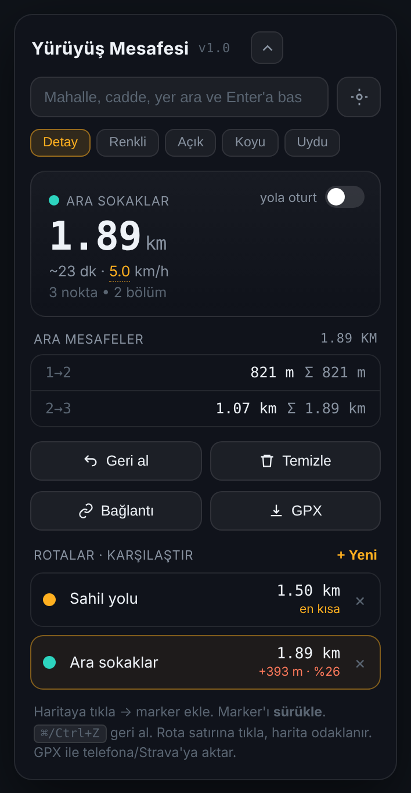

# Mesafeler

Haritaya marker koyarak **yürüdüğün gerçek mesafeyi** ölç, farklı sokak rotalarını yan yana karşılaştır.

**Canlı: [boxingkca.github.io/mesafeler](https://boxingkca.github.io/mesafeler/)**

[](LICENSE)


<p align="center"></p>

> English: a small, installation-free web tool to measure walking distance by dropping markers on a map, compare alternative street-by-street routes, estimate walking time, export GPX and share routes with a link. Turkish UI, tuned for Istanbul/Türkiye. See [Running locally](#yerelde-çalıştırma).

## Neden var

Harita uygulamalarında yürüme rotası seçtiğinde uygulama seni kendi seçtiği yoldan götürür ve sadece iki nokta arasındaki mesafeyi gösterir. Ama asıl merak edilen şey genelde şudur: *"Ben şu sokaklardan yürüsem toplam ne kadar tutar, uygulamanın önerdiği yola göre kaç metre fark eder?"*

Mesafeler bunu doğrudan yapar: istediğin kadar nokta koyarsın, her bölümün ve toplamın mesafesini görürsün, ikinci bir rota açıp ikisini kıyaslarsın.

## Özellikler

- **Sınırsız marker.** Haritaya tıkla, numaralı marker düşsün. Sürükleyerek düzelt, geri al, temizle.
- **Bölüm bölüm döküm.** Her marker çifti arası mesafe ve yürüyen toplam (Σ).
- **Rota karşılaştırma.** Birden fazla rota aç, en kısası işaretlenir, diğerlerinin farkı metre ve yüzde olarak yazılır.
- **Yola oturt.** İstersen noktaların arası gerçek yaya yoluna oturtulur (aşağıda açıklaması var).
- **Süre tahmini.** Mesafe ÷ yürüme hızı. Hız 4 ile 6 km/sa arasında değiştirilebilir.
- **Beş harita katmanı.** Detay (OSM), Renkli, Açık, Koyu ve Uydu. Siyah/gri tonlarda sokaklar zor seçiliyorsa Açık ya da Detay'a geç.
- **Türkiye odaklı arama.** Mahalle, cadde ya da yer adı yaz, Enter'a bas, çıkan adaylardan seç.
- **Otomatik kayıt.** Rotaların tarayıcında saklanır, sekmeyi kapatıp açınca yerinde durur.
- **Bağlantıyla paylaş.** Rotalar URL'e gömülür. Linki açan kişinin kendi rotaları ezilmez, paylaşılanlar yanına eklenir.
- **GPX dışa aktarma.** Telefona, Strava'ya ya da yedek olarak.
- **Telefonda rahat.** Panel katlanır, haritaya dokununca kendiliğinden kapanır. Safari'de "Ana Ekrana Ekle" ile uygulama gibi açılır.

## Kullanım

1. Haritada yürüyeceğin bölgeye git (arama kutusu ya da ⊙ konum düğmesi).
2. Haritaya tıklayarak sırayla marker koy. Toplam mesafe anlık güncellenir.
3. **+ Yeni** ile ikinci bir rota aç, aynı yolu başka sokaklardan çiz.
4. Rotalar listesinde her satırın sağında en kısa rotaya göre fark görünür. Satıra tıklarsan harita o rotaya odaklanır.
5. **Bağlantı** ile birine gönder, **GPX** ile dosya olarak indir.

### "Yola oturt" ne yapar

Kapalıyken (varsayılan) marker'lar arası **düz çizgi** ölçülür. Her köşeye marker koyarak tam istediğin yolu birebir çizersin. Bu mod her zaman çalışır ve sana tam kontrol verir.

Açıkken marker'lar arası, OpenStreetMap yaya ağı üzerinden hesaplanan **gerçek yürünebilir yola** oturtulur (kaldırım, yaya yolu, patika, yayalaştırılmış sokak). Birkaç ara nokta koyup gerisini yola bırakmak istediğinde kullanışlıdır. Araba rotası değildir: tek yönlü yol ya da otoyol mantığını izlemez, yaya yollarını kullanır.

Sonucun kalitesi OSM'deki kaldırım verisine bağlıdır. Google ya da Apple Maps'in verdiği rakamla birebir tutmayabilir; bu araç onların yerine geçmek için değil, **kendi seçtiğin yolu ölçmek** için yapıldı.

## Veri kaynakları ve gizlilik

Uygulamanın kendi sunucusu yoktur, hesap istemez, seni izlemez. Rotaların yalnızca **kendi tarayıcında** (`localStorage`) saklanır. Ama harita, arama ve yol hesabı için üçüncü taraf servislere istek atılır; bu servisler IP adresini ve istediğin bölgeyi görür:

| Ne için | Servis | Ne zaman |
|---|---|---|
| Harita karoları | OpenStreetMap, CARTO, Esri | Haritayı kaydırırken |
| Yer arama | OSM Nominatim | Aramada Enter'a basınca |
| Yola oturtma | FOSSGIS Valhalla | "Yola oturt" açıkken |

- Arama yazarken otomatik tamamlanmaz, yalnızca Enter ile çalışır. Bunun sebebi Nominatim kullanım politikasının otomatik tamamlamaya izin vermemesidir.
- Bu servisler ücretsiz kamu altyapısıdır. Aile ve arkadaş ölçeğinde sorun olmaz; yüksek trafikli bir kullanım için kendi servislerine geçmek gerekir.
- Paylaşım bağlantısındaki rota verisi URL'in `#` kısmında durur. Tarayıcı bu kısmı sunucuya göndermez.

## Yerelde çalıştırma

Derleme adımı yok. Statik dosyalardır.

```bash
git clone https://github.com/boxingkca/mesafeler.git
cd mesafeler
python3 -m http.server 8000
# tarayıcıda http://localhost:8000
```

`index.html` dosyasını doğrudan çift tıklayıp açmak da çalışır, ancak bazı tarayıcılar `file://` üzerinde pano ve konum izinlerini kısıtlar. Yerel sunucu daha sağlıklıdır.

## Proje yapısı

```
mesafeler/
├── index.html              Sayfa iskeleti ve meta etiketleri
├── manifest.webmanifest    Ana ekrana eklenebilir (PWA) tanımı
├── favicon.svg
├── assets/
│   ├── css/app.css         Tüm arayüz stilleri
│   ├── js/app.js           Uygulama mantığı
│   ├── js/config.js        Çalışma zamanı ayarları (gizli bilgi konmaz)
│   └── icons/              Uygulama ikonları
├── vendor/leaflet/         Leaflet 1.9.4 (depoya gömülü, CDN gerekmez)
├── docs/
│   ├── ARCHITECTURE.md     Kod yapısı ve tasarım kararları
│   └── APPLE-MAPS.md       Apple Maps (MapKit JS) kurulum rehberi
├── tools/
│   └── generate-mapkit-token.mjs
├── tests/e2e.py            Uçtan uca tarayıcı testi
└── .github/                CI, issue şablonları
```

## Test

Uçtan uca test gerçek bir Chromium açar: marker koyar, rota karşılaştırır, GPX indirir, paylaşım bağlantısını ve veri kaybı senaryolarını dener.

```bash
pip install playwright && playwright install chromium
python3 -m http.server 8777 &
python3 tests/e2e.py
```

## Yol haritası

- [ ] Apple Maps (MapKit JS) katmanı: Apple'ın harita, yer arama ve işletme/toplu taşıma gösterimi. Hazırlık rehberi [docs/APPLE-MAPS.md](docs/APPLE-MAPS.md) içinde.
- [ ] Rota çizgisini sürükleyerek araya nokta ekleme
- [ ] Yükseklik profili (hangi rota daha yorucu)
- [ ] GPX içe aktarma
- [ ] Çevrimdışı kabuk (service worker)

Değişiklikler için [CHANGELOG.md](CHANGELOG.md), katkı için [CONTRIBUTING.md](CONTRIBUTING.md).

## Lisans ve teşekkür

Kod [MIT](LICENSE) lisanslıdır. © 2026 Kadir Can Arabacı.

Harita verisi © [OpenStreetMap katkıcıları](https://www.openstreetmap.org/copyright) (ODbL). Karo stilleri © [CARTO](https://carto.com/attributions). Uydu görüntüsü Esri, Maxar, Earthstar Geographics. Harita motoru [Leaflet](https://leafletjs.com) (BSD-2-Clause). Yaya yönlendirmesi [FOSSGIS](https://fossgis.de) Valhalla sunucusu, arama [Nominatim](https://nominatim.org).
